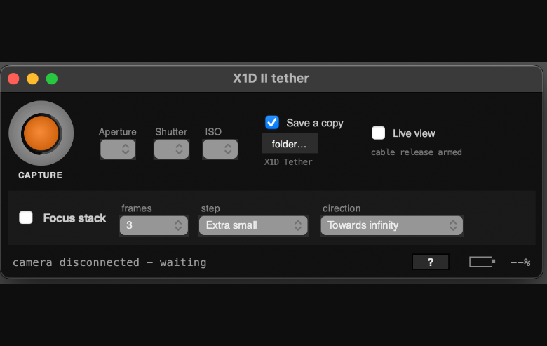

# X1D II Tether

A lightweight macOS tethering app for the Hasselblad X1D II that talks directly to the camera over USB, without Phocus or vendor SDKs.



The app exposes basic tether controls, live view, and capture workflow for a Hasselblad X1D II camera. The project includes a reverse-engineered USB protocol implementation and a small Tk-based viewer that pipes the H.264 live feed to `ffplay` for smoother preview rendering.

## Features

- Live view from the camera over USB
- Aperture, shutter, ISO control
- Focus stack controls and capture workflow
- Camera connection management and reconnection handling
- USB protocol and parameter handling implemented in Python
- macOS app bundle build script for packaging the app

## Repository layout

- `capture/` — app entry points and UI code
- `lib/` — USB protocol, camera driver, and live-view helpers
- `tools/` — additional protocol and capture utilities
- `analysis/` — technical notes, protocol docs, and traces
- `build_app.sh` — builds a macOS `.app` bundle
- `run_capture.sh` — launches the tether app

## Requirements

- macOS
- Python 3 with Tk available
- `ffplay` from FFmpeg on `PATH`
- `pyusb`
- `libusb` (the app bundler vendors it for the .app bundle)

## Build the app bundle

From the repository root:

```bash
./build_app.sh
```

To build and immediately open it:

```bash
./build_app.sh --open
```

This creates a bundle at:

```text
dist/X1D II Tether.app
```

The build script vendors `pyusb` and `libusb` into the app bundle so it does not depend on a specific Homebrew loader setup. `ffplay` is expected to be installed and available on your `PATH`.

## Run the tether app directly

```bash
./run_capture.sh
```

Or directly:

```bash
python3 capture/viewer.py
```

## Notes

- The camera must not be actively used by Phocus while tethering, because both apps claim the same USB interface.
- The app writes captures to the local filesystem path selected in the UI and expects a terminal session that can write to disk.
- More protocol details and build notes live in the `analysis/` folder and in the app source itself.

## More documentation

See the project’s technical notes in:

- `analysis/README.md`
- `analysis/PROTOCOL.md`
- `analysis/LIVEVIEW.md`
- `analysis/HBCTL.md`
