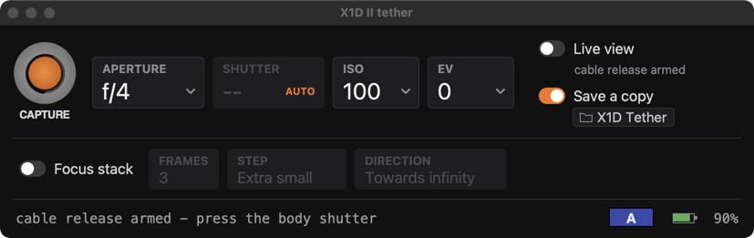
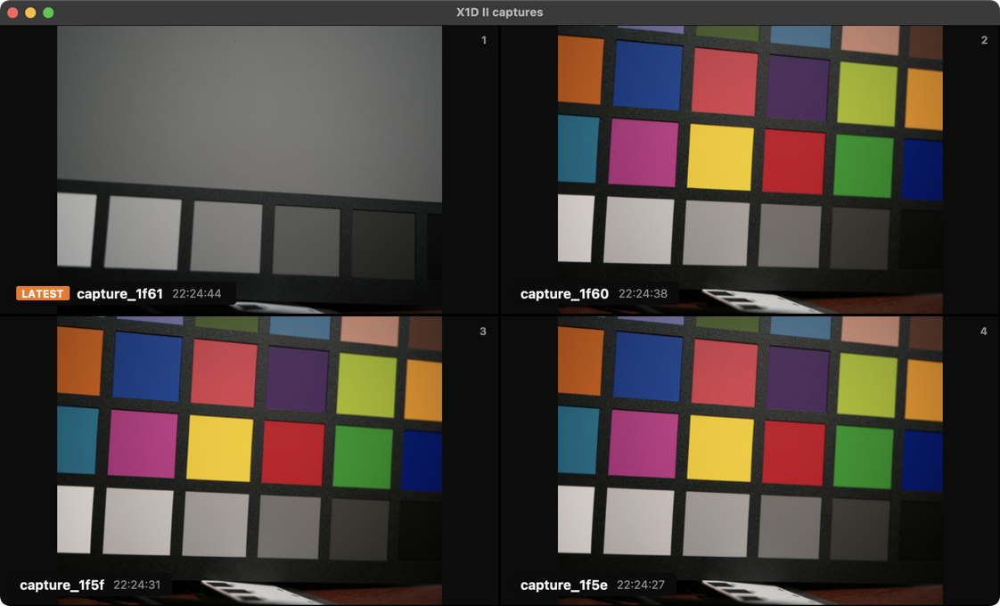
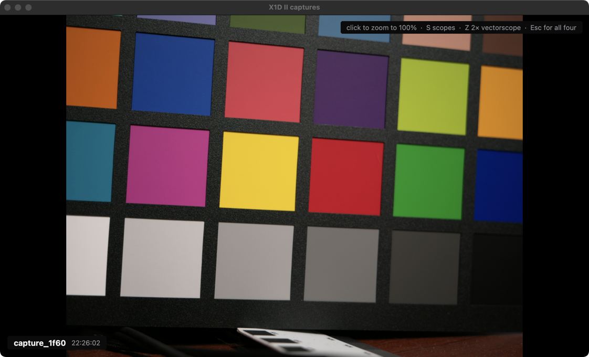
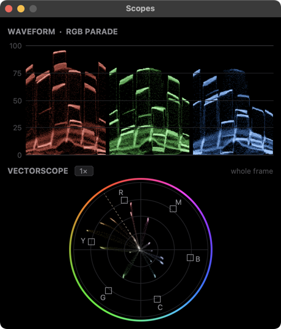
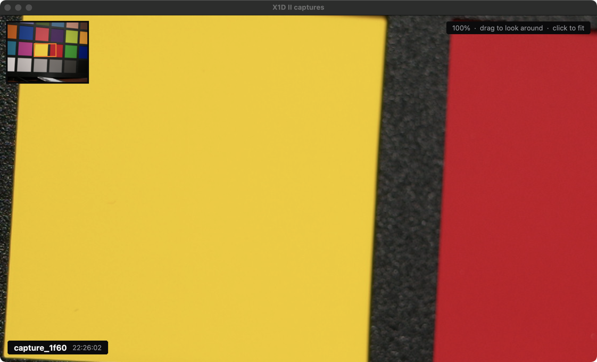
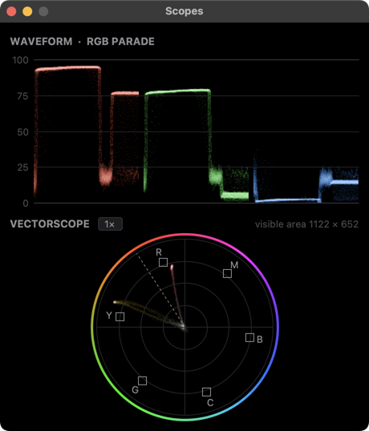

# X1D II Tether

A tethering app for the Hasselblad X1D II 50C on macOS. It runs the camera over USB directly,
with no Phocus and no vendor SDK. You can set the exposure, fire the shutter from the Mac or
the camera, run focus stacks, and review every shot with zoom and scopes the moment it lands.



## Features

**Exposure controls.** You get aperture, shutter, ISO and EV compensation as large tiles. They
follow the camera's dials both ways. A change made on the body shows up in the app at once,
and a change made in the app is read back from the camera to confirm it. Each tile greys out
according to the exposure mode (in **A** the shutter is set by the camera and marked *AUTO*).
It still shows the speed the camera has metered.

**Two ways to shoot.**
- *Live view on*: the camera's preview streams to its own window (2756×2064 H.264, about
  11 fps), and you shoot with the orange release or `Space`.
- *Live view off*: the camera's own shutter button and the cable release are armed. Every
  shot is pulled to the Mac as it is taken.

The camera can't do both at once: it will not fire from its body or cable while the preview
is streaming. Phocus works the same way.

**Save a copy.** Each full 50 MP `.3FR` is downloaded straight over USB into the folder you
pick, as well as being written to the card.

**Focus stacking.** The camera's own focus bracket, run from the app: 2 to 1000 frames, step
from extra small to extra large, towards infinity, towards near or both ways. The frames go to
the card only. The camera can't hand bracket frames to a computer; Phocus can't either.

**Captures gallery.** With live view off, the last four shots appear in a 2 × 2 grid, newest
first.



Click a picture to fill the window, and click again for all four. `1`–`4` and `Esc` do the
same from the keyboard.

**Zoom to 100% for checking focus.** Click a picture shown on its own to zoom to 100% around
that spot. Drag or scroll to look around; the small map in the corner shows where you are.
Click again to fit the whole picture.

**Scopes.** When a single picture is shown, a small scopes window shows an **RGB parade
waveform** and a **vectorscope**. They measure **only what is visible**: the whole frame when
it is fitted, and just the area on screen when you zoom in. So zooming in on one patch, face
or highlight measures exactly that.

<table>
<tr>
<td></td>
<td width="30%"></td>
</tr>
<tr>
<td></td>
<td></td>
</tr>
</table>

*Top: the whole frame of a colour chart. Bottom: zoomed to 100% on the yellow and red patches.
The scopes now measure only those two patches and the gap between them.*

- **Waveform**: one panel each for red, green and blue. Across is across the picture, up is
  0–100%, and the brighter a spot, the more pixels sit there.
- **Vectorscope**: the angle is hue and the distance from the centre is saturation. Boxes mark
  75% red, magenta, blue, cyan, green and yellow, and the dashed line is the skin tone line.
  Press `Z`, or click the scope or its **1×** button, for a **2×** zoom (as on Resolve's scope).
  This spreads out the low-saturation colours that skin and most real scenes are made of.
- Press `S` to show or hide the scopes. The window remembers where you put it.

**Status line.** The camera's exposure mode, its battery level and what the app is doing.

**Reconnection.** The app keeps working when the camera is unplugged and plugged back in, or
restarted.

## Keys

| key | where | does |
|---|---|---|
| `Space` / `Return` | controls, gallery | capture (runs the stack when Focus stack is on) |
| `1`–`4` | gallery | show that capture on its own |
| `Esc` | gallery | back to all four |
| click / drag / scroll | gallery | zoom to 100%, look around, fit again |
| `S` | gallery | show or hide the scopes |
| `Z` | gallery, scopes | vectorscope 1× / 2× |

## Running it

What you need:
- macOS on Apple silicon.
- A Python with Tk 9 (Tk 8.6.12 drops clicks while the app is in the background).
- `libusb`, and `ffplay` (from ffmpeg) for the live view.

```bash
brew install python-tk@3.13 libusb ffmpeg
/opt/homebrew/bin/python3.13 -m venv .venv
.venv/bin/python -m pip install pyusb pillow numpy
./run_capture.sh
```

Phocus must not be running, because it claims the same USB interface. Turn the camera's
screen on and leave it in shooting mode; it refuses transfers while asleep or in a menu.

To build a standalone app with everything bundled, including pyusb, Pillow, numpy and
libusb:

```bash
./build_app.sh            # dist/X1D II Tether.app
./build_app.sh --open     # build and launch
```

## Layout

```
capture/    the app
  viewer.py         controls window, camera handling, capture and download
  gallery.py        last-four gallery, zoom to 100%
  scopes.py         RGB parade and vectorscope
  widgets.py        the drawn tiles, switches and palette
  liveapp.py        live view only, no controls
lib/        the camera driver (USB protocol, parameters, live view)
tools/      command-line tools: read/write any parameter, list the card, intervalometer
tests/      unit tests: .venv/bin/python -m unittest discover tests
```

Nothing here flashes, patches or writes persistent state to the camera. Every command is one
the camera's own software sends.
